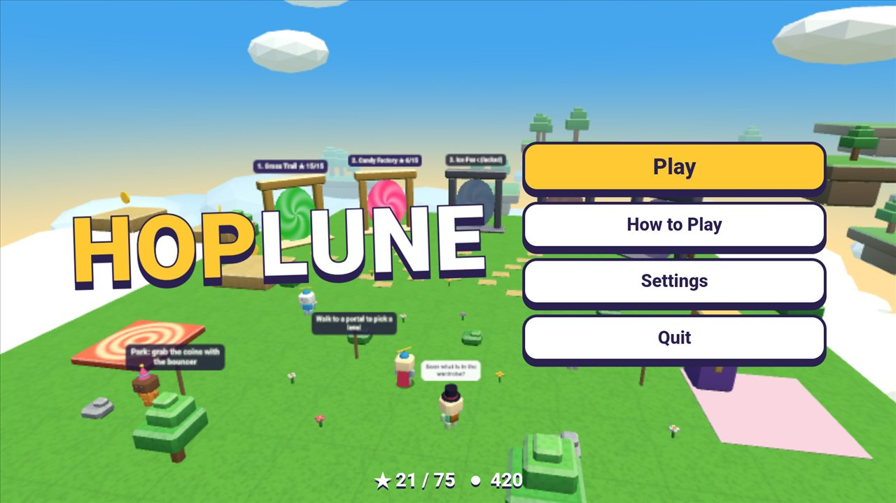
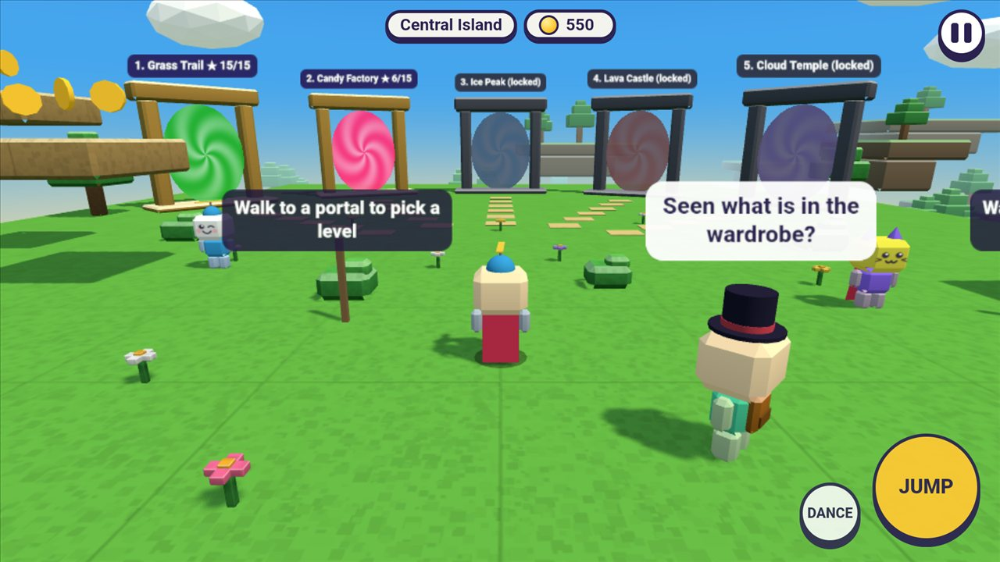
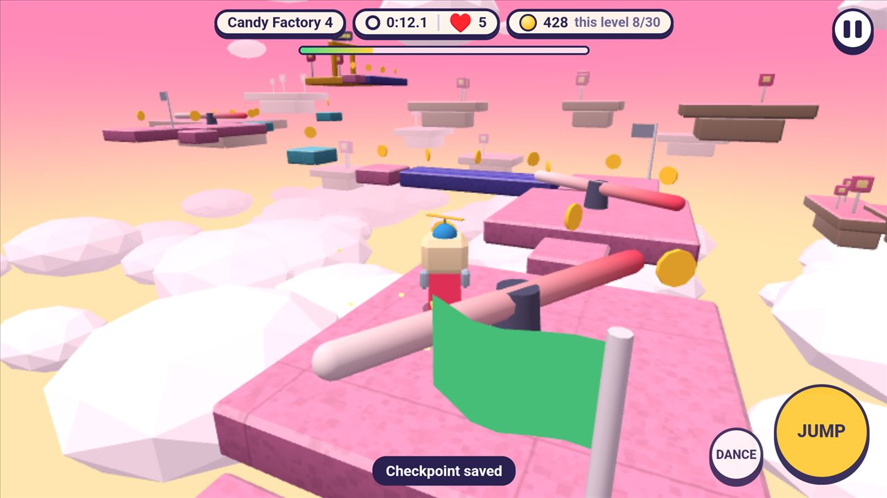
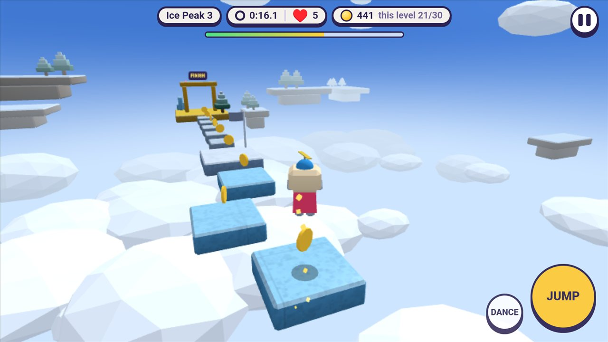
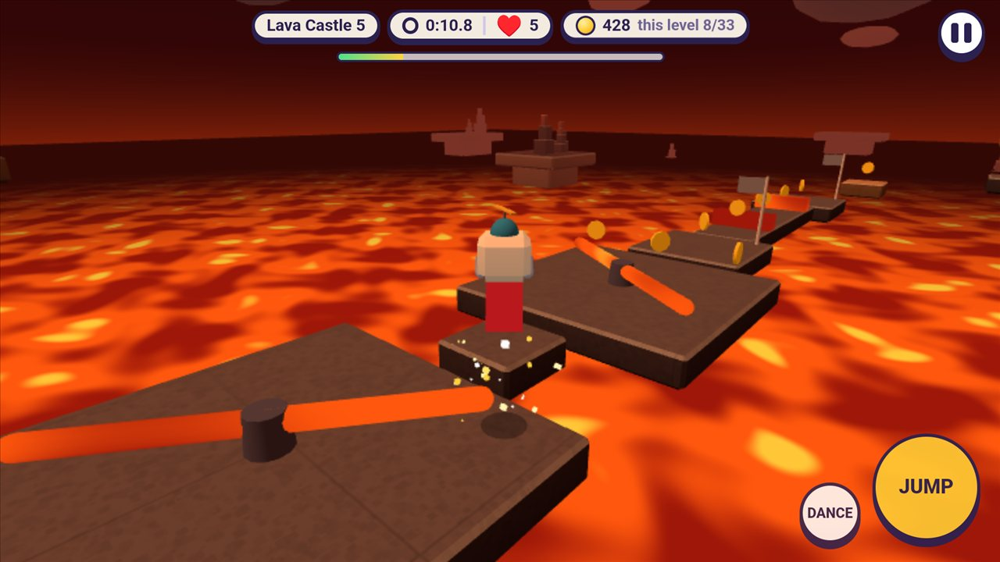
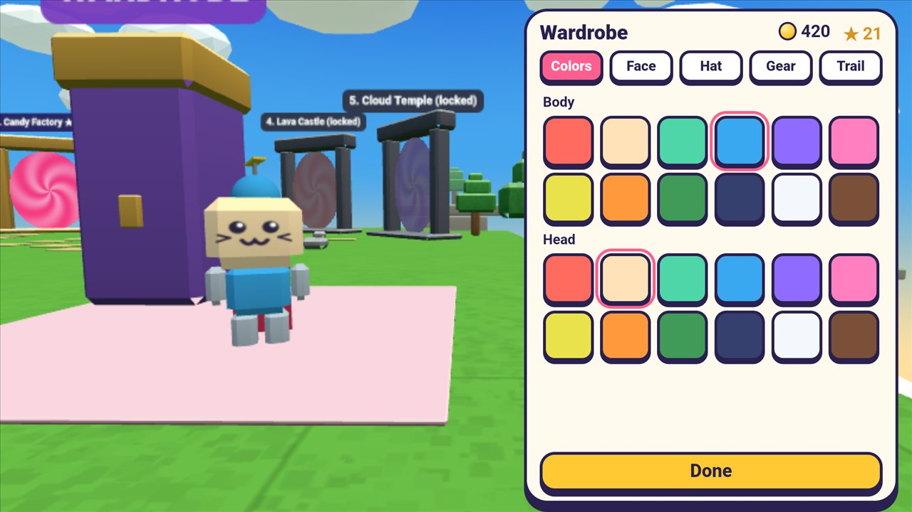

# Hoplune: Sky Parkour

A 3D obstacle course game for Android: hop across floating islands made of blocks, through 25 levels in 5 worlds. Plays offline, with no ads.

[Türkçe](#türkçe) · [Privacy policy](privacy.md)

  
  
  

  
  
  

Title · Central island · Candy Factory · Ice Peak · Lava Castle · Wardrobe

## Download

- **Android:** coming to Google Play.

## Features

- **25 levels in 5 worlds:** Grass Trail, Candy Factory, Ice Peak, Lava Castle and Cloud Temple. Each world has 5 levels, and they get harder as you go: moving platforms, conveyor belts, spinning bars, crumbling blocks, slippery ice, lava traps and wind columns.
- **5 lives per level:** every fall costs a life, and checkpoint flags keep your place. Run out of lives and the level starts again. No ads, no waiting.
- **Stars and coins:** earn up to 3 stars in every level by finishing it, grabbing every coin and beating the target time.
- **Wardrobe:** dress up your character with colours, faces, hats, back items and trails. The rarest items are unlocked with stars.
- **Central island:** doors to every world, friendly characters and a bouncy park full of coins.
- **Made for phones:** move with your left thumb, jump with your right. Plays offline, and progress is saved on your phone. English and Turkish; the game follows your phone's language and you can change it in Settings.

The game is free, with no ads and no in-app purchases. It does not ask for internet access and collects no data.

## Support

passlune.app@gmail.com

Built with three.js (MIT license). All models, textures, sounds and music were generated in code for this game; the text uses your phone's system fonts.

This repository holds the documentation only; the source code is not published here.

---

## Türkçe

Android için 3D engel parkuru oyunu: bloklardan yapılmış uçan adalarda, 5 dünyadaki 25 bölümü zıplayarak geç. İnternetsiz ve reklamsız oynanır.

[Gizlilik politikası](privacy.md#türkçe)

Ekran görüntüleri (yukarıda): Açılış · Merkez ada · Şeker Fabrikası · Buz Zirvesi · Lav Kalesi · Dolap

### İndir

- **Android:** yakında Google Play'de.

### Özellikler

- **5 dünyada 25 bölüm:** Çimen Patikası, Şeker Fabrikası, Buz Zirvesi, Lav Kalesi ve Bulut Tapınağı. Her dünyada 5 bölüm var ve ilerledikçe zorlaşıyor: gezen platformlar, yürüyen bantlar, dönen çubuklar, çöken bloklar, kaygan buz, lav tuzakları ve rüzgâr sütunları.
- **Her bölümde 5 can:** her düşüş bir can götürür, bayraklar kaldığın yeri tutar. Canlar biterse bölüm baştan başlar. Reklam yok, bekleme yok.
- **Yıldızlar ve paralar:** her bölümde bitirerek, bütün paraları toplayarak ve hedef süreyi geçerek 3 yıldıza kadar kazan.
- **Dolap:** karakterini renklerle, yüzlerle, şapkalarla, sırt eşyalarıyla ve izlerle giydir. En nadir parçalar yıldızla açılır.
- **Merkez ada:** her dünyaya açılan kapılar, sevimli karakterler ve paralarla dolu zıplama parkı.
- **Telefon için:** sol başparmağınla yürü, sağınla zıpla. İnternetsiz oynanır, ilerlemen telefonunda saklanır. Türkçe ve İngilizce; oyun telefonunun dilini izler, Ayarlar'dan değiştirebilirsin.

Oyun ücretsizdir; reklam ve uygulama içi satın alma yoktur. İnternet izni istemez ve veri toplamaz.

### Destek

passlune.app@gmail.com

three.js ile yapıldı (MIT lisansı). Bütün modeller, dokular, sesler ve müzik bu oyun için kodla üretildi; yazılarda telefonun kendi yazı tipleri kullanılır.

Bu depoda yalnızca belgeler bulunur; kaynak kod burada yayımlanmaz.
